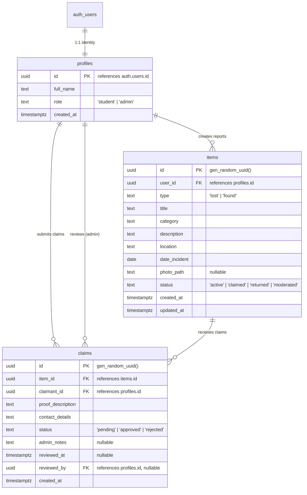

# FindIt — Database Schema & Security Architecture

This document details the PostgreSQL schema, Row Level Security (RLS) policies, storage access controls, and manual Supabase setup instructions for the **FindIt — Smart Campus Lost & Found Platform**.

---

## 1. Schema & Relationships

### Entity-Relationship Diagram



### Table Definitions

#### 1. `public.profiles`
| Column | Type | Constraints | Description |
| :--- | :--- | :--- | :--- |
| `id` | `UUID` | `PRIMARY KEY, REFERENCES auth.users(id) ON DELETE CASCADE` | Linked directly to Supabase Auth user. |
| `full_name` | `TEXT` | `NOT NULL, DEFAULT ''` | Display name of student or administrator. |
| `role` | `TEXT` | `NOT NULL, DEFAULT 'student', CHECK (role IN ('student', 'admin'))` | System authorization role. Default is always `'student'`. |
| `created_at` | `TIMESTAMPTZ` | `NOT NULL, DEFAULT timezone('utc'::text, now())` | Record creation timestamp. |

#### 2. `public.items`
| Column | Type | Constraints | Description |
| :--- | :--- | :--- | :--- |
| `id` | `UUID` | `PRIMARY KEY, DEFAULT gen_random_uuid()` | Unique report identifier. |
| `user_id` | `UUID` | `NOT NULL, REFERENCES public.profiles(id) ON DELETE CASCADE` | The user who posted the report. |
| `type` | `TEXT` | `NOT NULL, CHECK (type IN ('lost', 'found'))` | Distinguishes lost reports from found items. |
| `title` | `TEXT` | `NOT NULL, CHECK (length(trim(title)) > 0)` | Short title (e.g. "Hydroflask Bottle"). |
| `category` | `TEXT` | `NOT NULL, CHECK (length(trim(category)) > 0)` | Category (Electronics, Books, Keys, Cards, etc.). |
| `description` | `TEXT` | `NOT NULL, CHECK (length(trim(description)) > 0)` | Detailed description of the item. |
| `location` | `TEXT` | `NOT NULL, CHECK (length(trim(location)) > 0)` | Campus building/area (e.g. "Main Library 2nd Floor"). |
| `date_incident`| `DATE` | `NOT NULL, DEFAULT CURRENT_DATE` | Date item was lost or found. |
| `photo_path` | `TEXT` | `NULLABLE` | Path to photo in `item-photos` bucket (`{user_id}/{filename}`). |
| `status` | `TEXT` | `NOT NULL, DEFAULT 'active', CHECK (status IN ('active', 'claimed', 'returned', 'moderated'))` | Current lifecycle state of the item. |
| `created_at` | `TIMESTAMPTZ` | `NOT NULL, DEFAULT timezone('utc'::text, now())` | Incident report submission timestamp. |
| `updated_at` | `TIMESTAMPTZ` | `NOT NULL, DEFAULT timezone('utc'::text, now())` | Automatically updated via trigger. |

#### 3. `public.claims`
| Column | Type | Constraints | Description |
| :--- | :--- | :--- | :--- |
| `id` | `UUID` | `PRIMARY KEY, DEFAULT gen_random_uuid()` | Unique claim identifier. |
| `item_id` | `UUID` | `NOT NULL, REFERENCES public.items(id) ON DELETE CASCADE` | The found item being claimed. |
| `claimant_id` | `UUID` | `NOT NULL, REFERENCES public.profiles(id) ON DELETE CASCADE` | The student submitting the claim. |
| `proof_description` | `TEXT` | `NOT NULL, CHECK (length(trim(proof_description)) > 0)` | Confidential ownership proof (serial number, lockscreen wallpaper, marks). |
| `contact_details` | `TEXT` | `NOT NULL, CHECK (length(trim(contact_details)) > 0)` | Student phone / campus email for claim coordination. |
| `status` | `TEXT` | `NOT NULL, DEFAULT 'pending', CHECK (status IN ('pending', 'approved', 'rejected'))` | Claim status. |
| `admin_notes` | `TEXT` | `NULLABLE` | Optional moderation notes left by administrators. |
| `reviewed_at` | `TIMESTAMPTZ` | `NULLABLE` | Timestamp when claim was reviewed. |
| `reviewed_by` | `UUID` | `NULLABLE, REFERENCES public.profiles(id) ON DELETE SET NULL` | Administrator who made the decision. |
| `created_at` | `TIMESTAMPTZ` | `NOT NULL, DEFAULT timezone('utc'::text, now())` | Timestamp of claim submission. |

### Integrity & Unique Constraints
1. **No Duplicate Pending Claims:**
   ```sql
   CREATE UNIQUE INDEX idx_unique_pending_claim_per_user 
   ON public.claims(item_id, claimant_id) 
   WHERE (status = 'pending');
   ```
   *Guarantees a claimant cannot spam multiple pending claims on the same found item.*
2. **No Conflicting Approved Claims:**
   ```sql
   CREATE UNIQUE INDEX idx_unique_approved_claim_per_item 
   ON public.claims(item_id) 
   WHERE (status = 'approved');
   ```
   *Guarantees that once a claim is approved for an item, no second claim can be simultaneously approved without administrative resolution.*

---

## 2. Row Level Security (RLS) Policy Architecture

All tables have RLS enabled (`ALTER TABLE ... ENABLE ROW LEVEL SECURITY;`).

### 2.1 Admin Role Verification (`public.is_admin()`)
To verify administrator privileges safely without recursive policy evaluation, a `SECURITY DEFINER` function is used:
```sql
CREATE OR REPLACE FUNCTION public.is_admin()
RETURNS BOOLEAN
LANGUAGE sql
SECURITY DEFINER
STABLE
SET search_path = public
AS $$
    SELECT EXISTS (
        SELECT 1
        FROM public.profiles
        WHERE id = auth.uid() AND role = 'admin'
    );
$$;
```
- **Non-recursive design:** `public.profiles` allows public `SELECT (true)`. Therefore, querying `profiles` inside `is_admin()` does not trigger any recursive sub-queries.

### 2.2 Role Elevation Protection Trigger
To prevent non-admin users from altering their role (e.g. through a forged Supabase client `update({ role: 'admin' })`):
```sql
CREATE OR REPLACE FUNCTION public.prevent_role_self_elevation()
RETURNS TRIGGER
SECURITY DEFINER
SET search_path = public
LANGUAGE plpgsql
AS $$
BEGIN
    IF NEW.role <> OLD.role THEN
        IF NOT public.is_admin() THEN
            RAISE EXCEPTION 'Access denied: Only existing administrators can modify user roles.';
        END IF;
    END IF;
    RETURN NEW;
END;
$$;
```

### 2.3 Policy Breakdown

| Table | Operation | Target Role | Policy Rule / Using Expression | Security Purpose |
| :--- | :--- | :--- | :--- | :--- |
| **`profiles`** | `SELECT` | `public` | `true` | Public display of reporter full names without leaking secrets. |
| **`profiles`** | `UPDATE` | `authenticated` | `auth.uid() = id` | Users can update their display name; role changes are blocked by trigger. |
| **`items`** | `SELECT` | `public` | `status != 'moderated' OR (auth.uid() = user_id OR is_admin())` | Public can browse active listings; moderated items are quarantined to author & admins. |
| **`items`** | `INSERT` | `authenticated` | `auth.uid() = user_id AND status = 'active'` | Prevents posting on behalf of others or bypassing active state. |
| **`items`** | `UPDATE` | `authenticated` | `auth.uid() = user_id AND status IN ('active', 'claimed')` | Authors can modify details before completion; cannot moderate or mark returned. |
| **`items`** | `UPDATE` | `authenticated` | `public.is_admin()` | Admins have full moderation and status transition permissions. |
| **`items`** | `DELETE` | `authenticated` | `(auth.uid() = user_id AND status = 'active') OR public.is_admin()` | Authors can delete active reports; admins can prune listings. |
| **`claims`** | `SELECT` | `authenticated` | `auth.uid() = claimant_id OR public.is_admin()` | **CRITICAL:** Claim proofs and contact details are completely hidden from third parties and other students. |
| **`claims`** | `INSERT` | `authenticated` | `auth.uid() = claimant_id AND status = 'pending' AND EXISTS (active found item not owned by user)` | Students can only claim active found items reported by others; starts as `pending`. |
| **`claims`** | `UPDATE` | `authenticated` | `public.is_admin()` | **CRITICAL:** Claimants cannot self-approve claims or edit notes. Only admins can approve or reject. |
| **`claims`** | `DELETE` | `authenticated` | `(auth.uid() = claimant_id AND status = 'pending') OR public.is_admin()` | Claimants can withdraw pending claims; admins can remove claims. |

---

## 3. Storage Architecture (`item-photos` Bucket)

### Bucket Configuration
- **Bucket ID:** `item-photos`
- **Visibility:** Private (`public = false`)

### Folder Namespace Structure
Photographs are saved under a user-scoped directory:
```text
item-photos/{auth.uid()}/{item_id_or_random_uuid}.{ext}
```

### Storage RLS Policies
1. **Upload (`INSERT`):**
   ```sql
   CREATE POLICY "Users can upload item photos to own folder"
   ON storage.objects FOR INSERT TO authenticated
   WITH CHECK (
       bucket_id = 'item-photos'
       AND (storage.foldername(name))[1] = auth.uid()::text
   );
   ```
   *Guarantees users can only upload files into their own `{auth.uid()}` folder. Overwriting or writing to arbitrary namespaces is blocked.*
2. **Update (`UPDATE`):**
   Restricted to files where `(storage.foldername(name))[1] = auth.uid()::text`.
3. **Read (`SELECT`):**
   Restricted to authenticated users:
   ```sql
   CREATE POLICY "Photos viewable by authenticated users"
   ON storage.objects FOR SELECT TO authenticated
   USING (bucket_id = 'item-photos');
   ```

### Safe Retrieval on Frontend
Since the bucket is private, the frontend retrieves images using time-limited signed URLs generated via the Supabase client:
```javascript
// Example helper for image retrieval:
export async function getItemPhotoUrl(photoPath) {
  if (!photoPath) return null;
  const { data, error } = await supabase
    .storage
    .from('item-photos')
    .createSignedUrl(photoPath, 3600); // 1-hour expiry
  return data?.signedUrl || null;
}
```
*Alternatively, for public item listings, signed URLs or a public bucket policy can be configured if campus policy allows unrestricted thumbnail viewing.*

---

## 4. Manual Supabase Setup Procedure

Follow these exact steps in your Supabase Dashboard:

### Step 1: Open the SQL Editor
1. Go to your [Supabase Project Dashboard](https://supabase.com/dashboard).
2. Click on **SQL Editor** in the left sidebar.
3. Click **New Query**.
4. Copy the entire contents of [001_initial_schema.sql](file:///c:/Users/deyaa/OneDrive/Desktop/FindIt/supabase/migrations/001_initial_schema.sql) and paste into the editor.
5. Click **Run** (Ctrl + Enter).
6. Verify output displays: `Success. No rows returned`.

### Step 2: Verify Storage Bucket
1. Click on **Storage** in the left sidebar.
2. Confirm the `item-photos` bucket appears in the bucket list.
3. If not created automatically, click **New Bucket**, name it `item-photos`, and leave **Public Bucket** unchecked (private).

### Step 3: Configure Project Credentials Locally
1. In Supabase Dashboard, go to **Project Settings $\rightarrow$ API**.
2. Copy the **Project URL** and the **anon / public key** (never the `service_role` key).
3. In your project workspace, create a `.env` file from [.env.example](file:///c:/Users/deyaa/OneDrive/Desktop/FindIt/.env.example):
   ```bash
   cp .env.example .env
   ```
4. Paste the credentials into `.env`:
   ```env
   VITE_SUPABASE_URL=https://xxxxxxxxxxxx.supabase.co
   VITE_SUPABASE_ANON_KEY=eyJhbGciOiJIUzI1NiIsInR5cCI6...
   ```

### Step 4: Procedure for Promoting an Admin Account
Every newly registered user is created as a `student` by the secure database trigger. To promote an administrative campus staff account:
1. Have the admin user register normally via the application (or via Supabase Auth Dashboard).
2. In the Supabase **SQL Editor**, run the following promotion query:
   ```sql
   UPDATE public.profiles
   SET role = 'admin'
   WHERE id = (
       SELECT id FROM auth.users WHERE email = 'admin-email@campus.edu'
   );
   ```
3. Verify the role has updated:
   ```sql
   SELECT id, full_name, role FROM public.profiles WHERE role = 'admin';
   ```

---

## 5. Security Safeguards & Limitations

| Safeguard | Implementation Status | Note / Limitation |
| :--- | :--- | :--- |
| **Role Spoofing Prevention** | Fully Enforced | Registration trigger ignores client metadata for `role`. Direct update trigger (`prevent_role_self_elevation`) blocks tampering. |
| **Private Claims Privacy** | Fully Enforced | RLS strictly isolates claims to `claimant_id` and `is_admin()`. Regular users cannot query other students' claims. |
| **Claim Approval Integrity** | Fully Enforced | Claim updates restricted to `is_admin()`. Claimants cannot approve their own claims. |
| **Physical Return Separation** | Fully Enforced | Claim status (`approved`) is separate from item status (`claimed` vs `returned`). Physical return can only be marked by admin. |
| **Duplicate Claim Spam** | Partial Index Enforced | Only 1 pending claim per student per item allowed. Only 1 approved claim per item allowed. |
| **Photograph Isolation** | Policy Enforced | Users can only upload to `{auth.uid()}/` folder. |
| **Signed URL Expiry** | Application Level | Signed URLs are time-limited (e.g. 1 hour). When cached on client, URL must be re-signed after expiration. |
